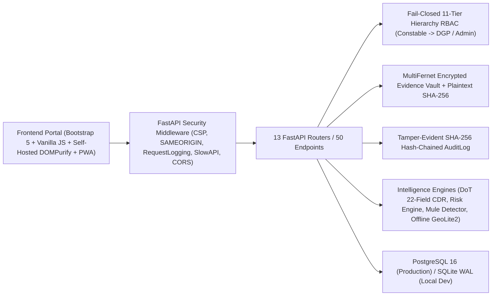

# N.E.T.R.A. — Network Evidence Tracking & Record Analysis

**N.E.T.R.A.** is a hardened cybercrime investigation, telecom requisitioning, and financial fraud intelligence platform built for Indian law enforcement operations. It combines hierarchical police RBAC, `MultiFernet`-encrypted evidence storage, Indian statutory workflows (**BNSS 2023** & **BSA 2023**), offline IP/cell-tower geolocation, and real-time fraud correlation.

## Live Deployment

- **Live Portal:** [https://netra-cyber-portal.onrender.com/frontend/index.html](https://netra-cyber-portal.onrender.com/frontend/index.html)
- **Cloud Stack:** Render Web Service (`netra-cyber-portal`) + Neon Serverless PostgreSQL 16 (`netra-db`)
- **Note:** Hosted on Render's free tier — the first request after ~15 minutes of inactivity may take ~50s to cold-start.

---

## Architecture Overview

---

## Security & Indian Cyber-Forensics Architecture

- **Fail-Closed 11-Tier Police Hierarchy RBAC (`backend/utils/rbac.py`):**
  - Scoped roles (`constable`, `head_constable`, `si`, `sho` -> station; `dy_sp` -> sub-division; `sp` -> district; `dig` -> range; `igp` -> zone) fail closed (`403 Forbidden`) whenever a user's jurisdiction field is unassigned or a request crosses jurisdiction boundaries. Only `dgp` and `admin` hold state-wide visibility.
- **`MultiFernet` Evidence Vault & Integrity (`backend/routers/files.py`):**
  - Computes raw-plaintext **SHA-256** prior to `MultiFernet` encryption (`ENCRYPTION_KEYS` supports seamless key rotation), re-verifies hashes on every download/view, and logs integrity mismatches.
- **Tamper-Evident Hash-Chained `AuditLog` (`backend/utils/audit.py`):**
  - Every security/investigative action appends an entry linked via `prev_hash` -> `entry_hash = SHA256(prev_hash|user_id|action|details|timestamp_utc)`, verifiable via `GET /admin/logs/verify`.
- **Hardened Web Security & Auth (`backend/middleware/security.py`, `backend/routers/auth.py`, `backend/utils/validation.py`):**
  - Strict `'self'` CSP with **air-gapped self-hosted frontend assets** (`frontend/vendor/`: Bootstrap 5, Bootstrap Icons, Chart.js, Vis-Network, `DOMPurify`, `jsPDF` — zero external CDN dependencies), `X-Frame-Options: SAMEORIGIN` + `blob:` previews (zero JWTs in URL query strings), server-side JWT `jti` revocation (`TokenBlocklist` + `POST /auth/logout`), magic-byte & anti-zip-bomb upload validation (`<= 100` files / `50 MB` uncompressed), production Swagger/OpenAPI schema lockdown (`ENVIRONMENT=production`), SlowAPI rate limiting on `/auth/token`, and ≥10-character mixed-complexity password enforcement.
- **Indian Statutory Alignment (`BNSS 2023` & `BSA 2023`) & Indexed Forensics:**
  - Official PDF requisitions cite **Section 94 BNSS, 2023** (`backend/utils/pdf_gen.py`), **Section 106 BNSS, 2023** freeze orders are exposed in `case_detail.html` (`POST /freeze/request/{case_id}`), and `Export Sec 63 BSA Certificate` downloads **Section 63(4)(c) BSA, 2023** manifests with Part A source-device declarations (`GET /files/case/{case_id}/bsa63-manifest`).
  - Uploaded CSV/Excel CDRs auto-index MSISDN/IMEI pairs into `CdrIndexEntry` for jurisdiction-scoped `/analysis/universal-search`, and `/analysis/network-graph` uses batched queries capped at `max_nodes=250` with a `truncated` indicator.
  - Admin Console (`admin.html`) provides one-click `Verify Audit Chain` (`GET /admin/logs/verify`) with DIG (`range_name`) / IGP (`zone_name`) officer provisioning, while the Admin sidebar link is hidden for non-supervisor roles (`si`, `constable`, `dy_sp`, `dig`, `igp`).

---

## Real-Dataset Benchmark Results

Verified against real public datasets in `scripts/ingest_real_datasets.py` (full metrics in [docs/DATASET_INTEGRATION_REPORT.md](docs/DATASET_INTEGRATION_REPORT.md)):

| Module | Dataset Used | Verified Benchmark |
| :--- | :--- | :--- |
| **Financial Risk Engine** | PaySim (`5,000` streamed rows; `300` `isFraud=1` mule accounts evaluated) | **283 / 300 (94.3%)** flagged `HIGH` / `CRITICAL` |
| **Mule Indicator Engine** | PaySim `TRANSFER -> CASH_OUT` chains | **292 / 300 (97.3%)** flagged `HIGH_VOLUME` / `RAPID_WITHDRAWAL` |
| **DoT 22-Field CDR & Tower Parser** | `real_telecom_cdr.csv` (101,174 rows; 500-row slice) + `dot_22field_cdr_sample.csv` + `india_towers.csv` (`218` India MCC `404`/`405` towers) | Auto-detected `subscriber_summary_cdr` (`152,070` calls) & `indian_dot_22field` (`2` IMEI->MultiSIM swaps, `2` SIM->MultiIMEI swaps, `4` resolved towers) |
| **Offline IP & ASN Lookup** | MaxMind `GeoLite2-City.mmdb` + `GeoLite2-ASN.mmdb` | Instant zero-leak offline resolution (e.g., `49.36.128.1` -> New Delhi, `AS55836 Reliance Jio Infocomm Limited`) |

---

### Seeded Demo Station Credentials
| Role / Station | Username | Password | Scope |
| :--- | :--- | :--- | :--- |
| **SI (`Sector-62 Cyber PS`)** | `si_sector62` | `Sector62#2026` | `FIR/GBN/2026/101` (CDR & DoT 22-field case) |
| **SHO (`Sector-62 Cyber PS`)** | `sho_sector62` | `ShoSec62#2026` | `Sector-62 Cyber PS` approvals & logs |
| **SI (`Noida Central PS`)** | `si_noida_central` | `CentralNoida#2026` | `FIR/GBN/2026/102` (PaySim mule fraud case) |
| **DGP (`Statewide`)** | `dgp_state` | `NetraDgp#2026` | Statewide visibility & `/admin/logs/verify` |
| **Admin** | `netra_admin` | `NetraAdmin#2026` | User lifecycle & audit chain verification |

---

