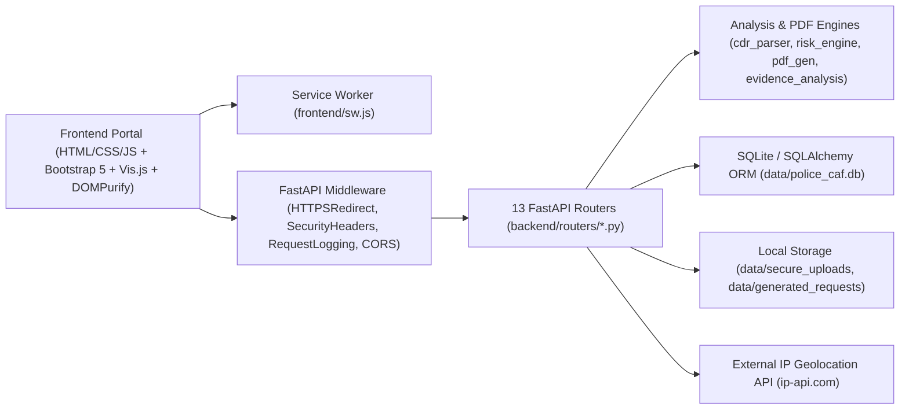
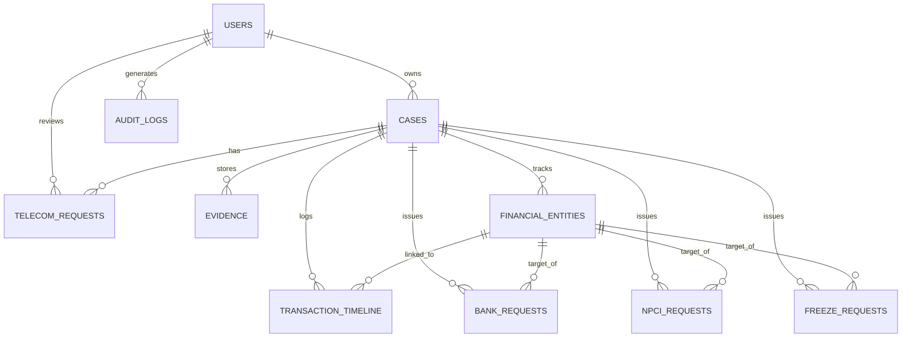

# N.E.T.R.A. — Research & Development (R&D) Report

**Project:** N.E.T.R.A. (*Network Evidence Tracking & Record Analysis*)  
**Domain:** Law Enforcement Case Management, Telecom Requisitioning & Cyber-Financial Fraud Intelligence  
**Scope:** Full-stack codebase audit, system architecture, data model, security posture, technical gaps, and R&D roadmap.

---

## 1. Executive Summary

N.E.T.R.A. is a centralized **FastAPI + SQLite + Vanilla JS/Bootstrap 5** investigation portal designed for police cybercrime units. It combines:

1. **Hierarchical Case & FIR Management** with station-to-state (Constable -> DGP) role-based visibility.
2. **Telecom & Legal Requisition Workflows** for CAF/CDR/IP logs, bank KYC/statements, NPCI/UPI traces, and Section 102 CrPC urgent account freeze requests, including automated PDF letter generation.
3. **Encrypted Evidence Vault** using Fernet symmetric encryption and SHA-256 integrity verification on view.
4. **Rule-Based Fraud & Telecom Intelligence** covering CDR parsing, universal identifier search, network-graph correlation, tower-dump intersection, batch file extraction, and entity risk scoring.

### Key R&D Takeaways
- **Strengths:** Clean domain modeling across 10 SQLAlchemy tables (`backend/models.py`), solid core patterns for evidence encryption/hashing (`backend/routers/files.py`), explainable weighted risk scoring (`backend/utils/risk_engine.py`), and multi-level police hierarchy scoping in case queries.
- **Critical Gaps Identified:** Unauthenticated file upload endpoint (`backend/routers/evidence.py`), unprotected audit log endpoint (`backend/routers/admin.py`), incomplete SlowAPI rate-limiter wiring (`backend/main.py` vs `backend/routers/auth.py`), CSP blocking `cdnjs.cloudflare.com` (DOMPurify), case-mismatch bug in mule detection (`backend/routers/financial_analytics.py`), and missing jurisdiction checks on several financial/evidence endpoints.
- **Next R&D Phase:** Harden auth/RBAC consistency, fix runtime bugs, migrate from SQLite to PostgreSQL + Alembic migrations, replace static/demo lookups (IP geolocation, nodal emails) with verified feeds, and introduce graph/ML anomaly detection.

---

## 2. System Architecture

### Technology Stack
| Layer | Technologies Observed | Source |
| :--- | :--- | :--- |
| **Backend Web Framework** | FastAPI, Uvicorn, Gunicorn (`UvicornWorker`) | `backend/main.py`, `requirements.txt`, `deploy/Procfile` |
| **ORM & Database** | SQLAlchemy (`declarative_base`), SQLite (`data/police_caf.db`) | `backend/database.py`, `backend/models.py` |
| **Auth & Crypto** | `python-jose` (HS256 JWT), `passlib` (`pbkdf2_sha256`), `cryptography.fernet`, SHA-256 | `backend/utils/security.py`, `backend/routers/files.py` |
| **Data & Document Engines** | `pandas`, `openpyxl`, `reportlab`, `matplotlib`, `PyPDF2` (optional), `pytesseract`/`PIL` (optional) | `requirements.txt`, `backend/utils/` |
| **Frontend UI** | HTML5, Vanilla JS, Bootstrap 5, Bootstrap Icons, `DOMPurify`, `jszip`, `mammoth`, `xlsx` | `frontend/`, `frontend/js/lib/` |
| **Middleware & Hardening** | `SecurityHeadersMiddleware`, `RequestLoggingMiddleware`, `CORSMiddleware`, `slowapi` | `backend/middleware/security.py`, `backend/routers/auth.py` |

---

## 3. Data Model & Entity Relationships

Defined in `backend/models.py` (10 tables):

### Role Hierarchy (`UserRole`)
1. **Station Level:** `constable`, `head_constable`, `si` (`SUB_INSPECTOR`), `sho` (`INSPECTOR`) — scoped to `station_name`.
2. **Sub-Division / District:** `dy_sp` (scoped to `sub_division`), `sp` (scoped to `district_name`).
3. **Range / Zone / State:** `dig` (`range_name`), `igp` (`zone_name`), `dgp` (state-wide visibility).
4. **Administrative / Legacy:** `admin`, `officer`.

---

## 4. Module & API Inventory (50 Endpoints Across 13 Routers)

| Router Module | Prefix | Key Capabilities |
| :--- | :--- | :--- |
| `backend/routers/auth.py` | `/auth` | OAuth2 password token login (5/min limiter decorator), Admin-only user registration, `/me`, password change |
| `backend/routers/cases.py` | `/cases` | FIR case creation, hierarchical RBAC case listing & detail retrieval, status updates |
| `backend/routers/requests.py` | `/requests` | Single & batch telecom CAF/CDR requests, Section 91 CrPC PDF generation, approve/reject/dispatch, result upload/download |
| `backend/routers/files.py` | `/files` | Fernet-encrypted evidence upload with SHA-256 hash, case listing, download & inline view with tamper check |
| `backend/routers/evidence.py` | `/evidence` | Standalone `/evidence/upload` analyzer saving unencrypted copy and running `process_file` |
| `backend/routers/analysis.py` | `/analysis` | CDR analysis (`/cdr/{id}`), universal search, comprehensive investigation aggregation, network graph, batch file search |
| `backend/routers/tools.py` | `/tools` | IP/domain geolocation via `ip-api.com` (with offline demo fallback), multi-file tower-dump/financial intersection |
| `backend/routers/financial_entities.py` | `/financial-entities` | CRUD and SHO+ verification for bank accounts, UPI IDs, wallets, crypto wallets |
| `backend/routers/bank_requests.py` | `/bank` | Bank KYC/statement request workflow + nodal officer contact lookup (`backend/nodal_contacts.py`) |
| `backend/routers/npci_requests.py` | `/npci` | NPCI/UPI transaction history request workflow + UPI nodal contact lookup |
| `backend/routers/freeze_requests.py` | `/freeze` | Section 102 CrPC urgent account freeze workflow & status tracking |
| `backend/routers/financial_analytics.py` | `/analytics` | Case transaction timeline, mule account indicators, repeat-entity cross-FIR alerts, financial dashboard |
| `backend/routers/admin.py` | `/admin` | Recent audit log retrieval (`limit(100)`) |

---

## 5. Analytical & Intelligence Engines

### 5.1 Entity Risk Engine (`backend/utils/risk_engine.py`)
Computes an explainable 0–100 score using a weighted linear model:

$$\text{Score} = 0.4 \cdot \text{RepeatOffense} + 0.3 \cdot \text{MoneyFlow} + 0.3 \cdot \text{Network}$$

- **Repeat Offense (40%):** Saturated at 5 linked cases (`min(case_count / 5, 1.0) * 100`).
- **Money Flow (30%):** Saturated at ₹1,00,000 (`min(total_amount / 100000, 1.0) * 100`).
- **Network Connectivity (30%):** Saturated at 5 combined evidence files + telecom requests.
- **Thresholds:** `>= 75` (`CRITICAL`), `>= 40` (`HIGH`), `< 40` (`MODERATE`), paired with explainability tags (e.g., Serial Offender, Inter-District Gang, Recently Active).

### 5.2 CDR & Evidence Parsers
- **CDR Parser (`backend/utils/cdr_parser.py`):** Heuristic column-name matching for `datetime`, `source`, `destination`, `duration`, and `imei`; outputs call counts, duration sum, top-10 incoming/outgoing contacts, and hourly activity distribution.
- **Evidence Analyzer (`backend/utils/evidence_analysis.py`):** Extracts factual content with confidence ratings (`High`/`Medium`/`Low`) across text, CSV/TSV (`pandas` + `csv` fallback), Excel, PDF (`PyPDF2`), and images (`PIL` + `pytesseract`), returning an explicit legal notice preserving primary evidence integrity.
- **Tower Dump Analyzer (`backend/routers/tools.py`):** Computes cross-file set intersections for 10-digit Indian mobile numbers (`[6-9]\d{9}`), UPI handles (`@`), and 9–18 digit numeric account strings.

---

## 6. Security, Correctness & Engineering Audit Findings

### 6.1 High-Priority Security Findings
1. **Unauthenticated Evidence Upload (`backend/routers/evidence.py`):** `POST /evidence/upload` has no `Depends(get_current_active_user)` dependency, stores raw unencrypted files, and interpolates `file.filename` directly without calling `sanitize_filename()` (`backend/utils/validation.py`).
2. **Unrestricted Audit Log Access (`backend/routers/admin.py`):** `GET /admin/logs` has its role check commented out (lines 33–34), allowing any authenticated officer (including `constable`) to query system-wide audit logs.
3. **Inconsistent RBAC Across Jurisdiction Endpoints:**
   - `backend/routers/files.py` (`/files/view/{evidence_id}`) validates JWT via a `?token=` query parameter (exposing JWTs in logs/history) and omits the jurisdiction check implemented in `/files/download/{evidence_id}`.
   - `backend/routers/financial_entities.py` and `backend/routers/financial_analytics.py` (`/timeline/{case_id}`, `/mule-indicators/{account_number}`, `/repeat-entities`) do not scope results to the user's station/district/range/zone.
4. **SlowAPI Rate Limiter Not Wired to App (`backend/routers/auth.py`, `backend/main.py`):** `@limiter.limit("5/minute")` is attached to `/auth/token`, but `app.state.limiter` and `RateLimitExceeded` exception handling are missing in `backend/main.py`.
5. **CSP Blocks DOMPurify CDN (`backend/middleware/security.py` vs `frontend/index.html`):** `frontend/index.html` loads DOMPurify from `cdnjs.cloudflare.com`, which is omitted from `script-src` in `SecurityHeadersMiddleware`, causing browsers enforcing CSP to block DOMPurify and fall back to basic escaping.
6. **Secrets & Password Policy Weaknesses:**
   - `.env` is tracked in git history (`.gitignore` now prevents future accidental commits locally, but history remains exposed if pushed publicly).
   - `validate_password_strength` (`backend/utils/validation.py`) allows 4-character alphanumeric PINs (`"1234"`), and `backend/utils/security.py` uses `pbkdf2_sha256` while `requirements.txt` specifies `passlib[bcrypt]`.

### 6.2 Functional Bugs & Technical Debt
1. **Mule Detection Enum Case Mismatch (`backend/routers/financial_analytics.py` lines 88–89):** Checks `t.event_type == "PAYMENT"` and `["WITHDRAWAL", "TRANSFER"]` in uppercase, whereas `TransactionEventType` in `backend/models.py` defines lowercase values (`"payment"`, `"withdrawal"`, `"transfer"`). Consequently, `inflow` and `outflow` compute to `0`.
2. **Potential `AttributeError` on Missing Cases (`backend/routers/financial_analytics.py` lines 128, 178, 196):** Calls `.fir_number` on `.first()` query results without checking for `None`.
3. **Timezone Comparison Crash Risk (`backend/utils/risk_engine.py` lines 79–80):** `datetime.fromisoformat(last_event)` compared against naive `datetime.now()` raises `TypeError` when `event_timestamp` carries timezone offset information.
4. **CORS Port Mismatch (`backend/config.py` line 38):** Default `ALLOWED_ORIGINS` uses port `8000` (`http://localhost:8000`), while `run.sh`, `README.md`, and `frontend/js/api.js` target port **`8001`**.
5. **Offline Demo Fallback Masked as Lookup (`backend/routers/tools.py` lines 89–106):** `ip_lookup` catches all exceptions (including `HTTPException` raised on lines 60 and 71 if nested, or network errors to `http://ip-api.com` with no `timeout`) and returns hardcoded Lucknow/Jio mock coordinates.
6. **Service Worker Path Mismatch (`frontend/sw.js`):** Caches `/index.html`, `/css/styles.css`, etc. at root instead of `/frontend/...` where FastAPI mounts static files, and checks `/api/` despite backend routes having no `/api/` prefix.
7. **Minor Code Hygiene Issues:** Duplicate `router = APIRouter(...)` in `backend/routers/analysis.py` (lines 12–21), duplicate `is_first_login: bool` in `backend/schemas.py` (`UserResponse` lines 25–26), duplicate imports in `backend/utils/security.py`, `bleach` unused in `requirements.txt`, and `PyPDF2`/`PIL`/`pytesseract` used in code without being listed in `requirements.txt`.

---

## 7. Prioritized R&D Roadmap

| Phase | Priority | Focus Area | Concrete Deliverables |
| :--- | :--- | :--- | :--- |
| **Phase 1: Stabilization & Security** | P0 | Auth, RBAC & Bug Fixes | Require auth + encryption + `sanitize_filename` on `/evidence/upload` (or deprecate in favor of `/files/upload`); restrict `/admin/logs` to `admin`/`sho`; wire SlowAPI to `app.state`; fix `TransactionEventType` casing in `financial_analytics.py`; self-host DOMPurify in `frontend/js/lib/`; fix CORS default port `8001` and `sw.js` paths. |
| **Phase 2: Data & Infrastructure** | P1 | Persistence & Testing | Add `pytest` + `httpx` automated API & RBAC test suite; introduce Alembic migrations; support PostgreSQL via `DATABASE_URL` env var; move `deploy/` configs or add platform build flags if deploying to Render/Heroku/GitHub Pages. |
| **Phase 3: Intelligence Upgrades** | P2 | Telecom & Financial Analytics | Column-mapping UI + strict schema normalization for varied Indian TSP CDR formats; offline MaxMind GeoLite2 DB replacing unencrypted `http://ip-api.com`; entity disambiguation between 10-digit mobile numbers and bank accounts in tower dumps; background task queue for large spreadsheets/PDFs. |
| **Phase 4: Advanced R&D** | P3 | Graph & ML Capabilities | Community detection / PageRank centrality over the case-entity-telecom graph to surface mule rings; temporal burst anomaly detection across transaction timelines; court-admissible Section 65B / BSA certificate export alongside SHA-256 evidence manifests. |
